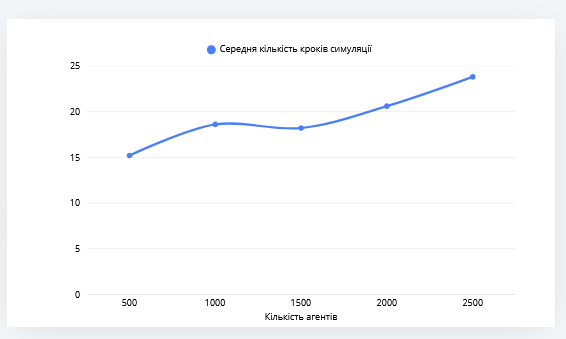
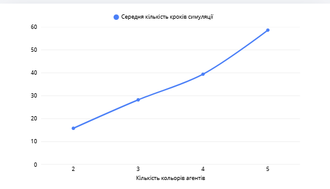
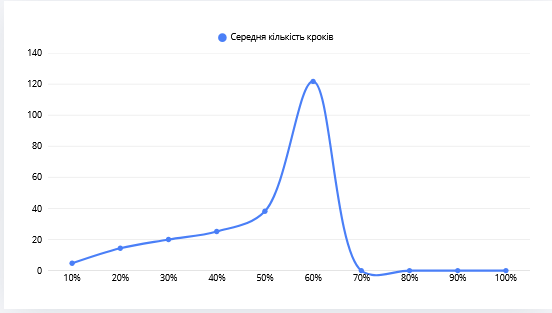
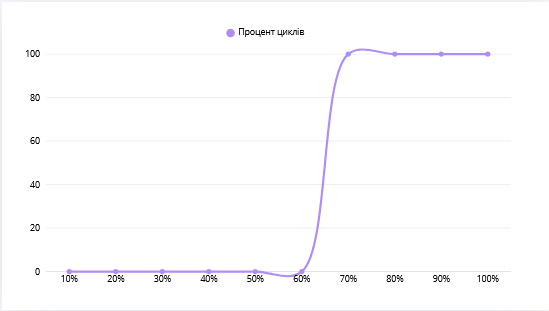

## Комп'ютерні системи імітаційного моделювання
## СПм-25-1, **Царенко Денис Олегович**
### Лабораторна робота №**1**. Опис імітаційних моделей та проведення обчислювальних експериментів

 

[Segregation Simple Extension 1](https://www.netlogoweb.org/launch#http://www.netlogoweb.org/assets/modelslib/IABM%20Textbook/chapter%203/Segregation%20Extensions/Segregation%20Simple%20Extension%201.nlogo)

 

### Вербальний опис моделі:
Симуляція опису зміни рівня щастя множини людей відповідно до кількості оточуючих, що відрізняються від них (у цій моделі - різні кольори черепах). На полотні створюється задана користувачем кількість черепах, що завжди є меншою за розмір полотна. Кількість кольорів - до 5 (червоний, зелений, жовтий, синій, помаранчевий). Для кожної черепахи прораховується процент щастя (вираховується як середній процент черепах того ж кольору у восьми сусідніх клітинках), якщо він нижче за задану користувачем планку, то така черепаха шукає і переміщається на наступне місце (повертається на рандомний кут та рухається рандомну кількість клітинок, до 10), допоки не знайде вільне. Проходить тік, повторюється допоки кількість нещасливих черепах не стане 0. Результат виконання - групування черепах за кольором у одну або декілька груп з різним розміром, деякі черепахи стають вигнанцями без сусідів.

### Керуючі параметри:
- **number** - кількість черепах, які будуть створені
- **%-similar-wanted** - відсоток сусідів такого ж кольору, нижче якого черепаха вважатиметься нещасливою
- **number-of-ethnicities** - кількість видів (кольорів) черепах

### Внутрішні параметри
- **happy?** - булевий флаг, визначає чи агент щасливий
- **similar-nearby** - кількість черепах того ж кольору, що й агент у 8 сусідніх патчах
- **total-nearby** - загальна кількість черепах-сусідів у 8 сусідніх патчах від агента

### Показники роботи системи
- середній відсоток схожих сусідів. У кінці симуляції не може бути менше за керуючий параметр %-similar-wanted.
- процент нещасливих агентів. Показує нестабільність системи та процентну кількість черепах, що на наступному тіку симуляції точно змінять своє місцезнаходження

### Примітки
Параметр проценту сусідів є найважливішим з трьох.

### Недоліки
Через випадкову природу переміщення агентів, при заданні проценту бажаних сусідів вище ніж 50% є великий шанс того, що симуляція йтиме набагато довше, ніж при параметрах за замовчуванням. Зменшення загальної кількості черепах є виходом з ситуації, але в ситуаціях коли створено велику кількість черепах, така симуляція потенційно може тривати вічно.

### Обчислювальні експерименти
## 1. Вплив кількості агентів на час симуляції при стандартному порозі у 30% та 3 кольорах. Дані розраховано як середнє значення після 5 проходів.

<table>
	<thead>
		<tr>
		<th>Кількість агентів</th>
		<th>Середня кількість кроків симуляції</th>
		</tr>
	</thead>
	<tbody>
		<tr>
			<td>500</td>
			<td>15.2</td>
		</tr>
		<tr>
			<td>1000</td>
			<td>18.6</td>
		</tr>
		<tr>
			<td>1500</td>
			<td>18.2</td>
		</tr>
		<tr>
			<td>2000</td>
			<td>20.6</td>
		</tr>
		<tr>
			<td>2500</td>
			<td>23.8</td>
		</tr>
	</tbody>
</table>

Збільшення кількості агентів на 500 дає середнє збільшення часу симуляції на три кроки. Через випадковість процесів це правило не завжди працює, 
і різниці може і не бути, як при переході 1000-1500.

## 2. Вплив кількості кольорів агентів на час симуляції при 2000 агентах та порозі у 40%. Дані розраховано як середнє значення після 5 проходів.

<table>
	<thead>
		<tr>
		<th>Кількість кольорів</th>
		<th>Середня кількість кроків симуляції</th>
		</tr>
	</thead>
	<tbody>
		<tr>
			<td>2</td>
			<td>15.8</td>
		</tr>
		<tr>
			<td>3</td>
			<td>28.2</td>
		</tr>
		<tr>
			<td>4</td>
			<td>39.4</td>
		</tr>
		<tr>
			<td>5</td>
			<td>58.6</td>
		</tr>
	</tbody>
</table>

Кожне нове збільшення кількості призводить до середнього збільшення часу симуляції на 14.4 кроки. Перехід з 4 на 5 кольорів є найбільшим (19.2 кроки).

## 3. Вплив порогу схожості сусідів на час виконання та ймовірність зациклення. Кількість агентів - 2000, кількість кольорів - 3. Значення розраховуються після 10 проходів. Першопочатковий поріг - 10%, крок - 10%. Візьмемо, що зацикленням вважається таймаут у 1500 кроків.

<table>
	<thead>
		<tr>
		<th>Поріг схожих</th>
		<th>Середня кількість кроків</th>
		<th>відсоток таймаутів</th>
		</tr>
	</thead>
	<tbody>
		<tr>
			<td>10</td>
			<td>4.7</td>
			<td>0%</td>
		</tr>
		<tr>
			<td>20</td>
			<td>14.4</td>
			<td>0%</td>
		</tr>
		<tr>
			<td>30</td>
			<td>20</td>
			<td>0%</td>
		</tr>
		<tr>
			<td>40</td>
			<td>25.2</td>
			<td>0%</td>
		</tr>
		<tr>
			<td>50</td>
			<td>38.2</td>
			<td>0%</td>
		</tr>
		<tr>
			<td>60</td>
			<td>121.8</td>
			<td>0%</td>
		</tr>
		<tr>
			<td>70</td>
			<td>-</td>
			<td>100%</td>
		</tr>
		<tr>
			<td>80</td>
			<td>-</td>
			<td>100%</td>
		</tr>
		<tr>
			<td>90</td>
			<td>-</td>
			<td>100%</td>
		</tr>
		<tr>
			<td>100</td>
			<td>-</td>
			<td>100%</td>
		</tr>
	</tbody>
</table>

В цьому випадку, перехід від 50% до 60% підвищує час симуляції у середньому у 3 рази, на відміну від середнього підвищення на 8.38 кроків, а перехід від 60% до 70% та на вищі проценти змушує симуляцію зациклитися, що й було описано у недоліках.