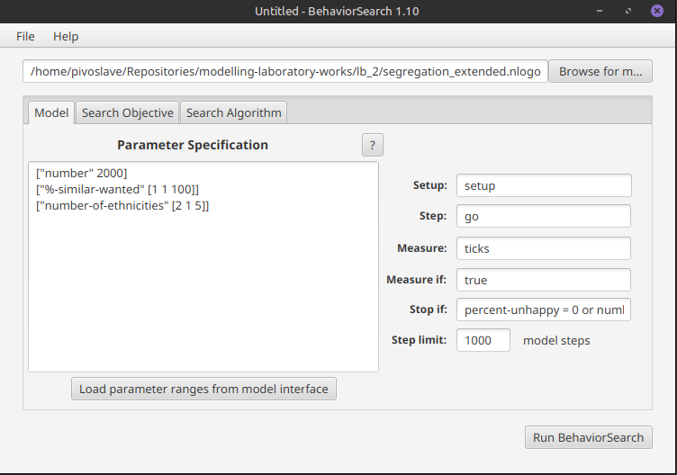
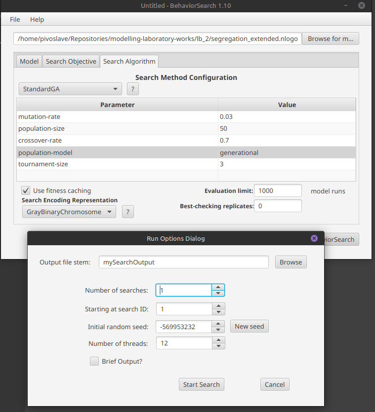
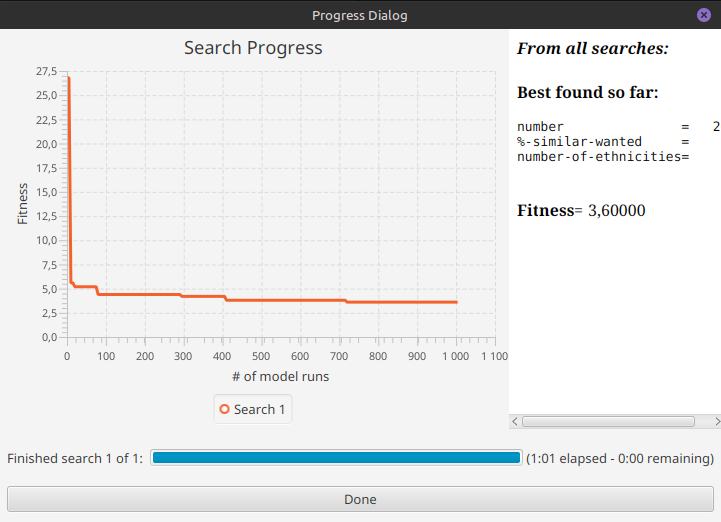
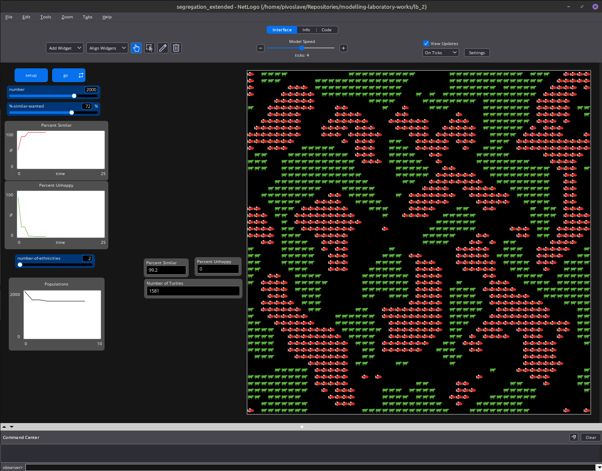
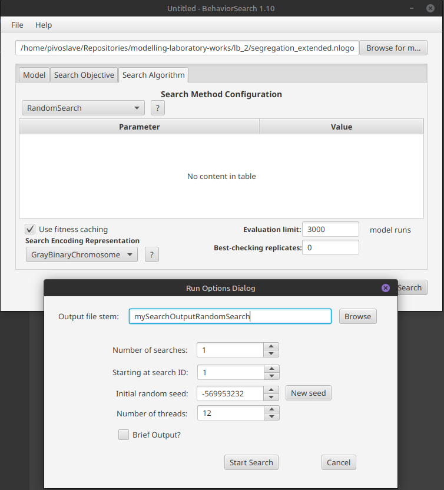
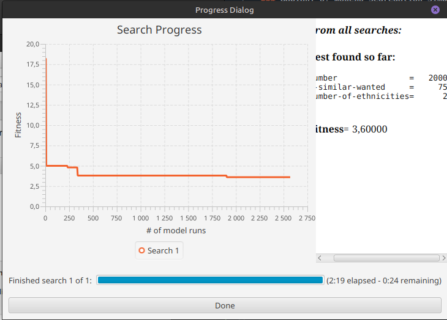
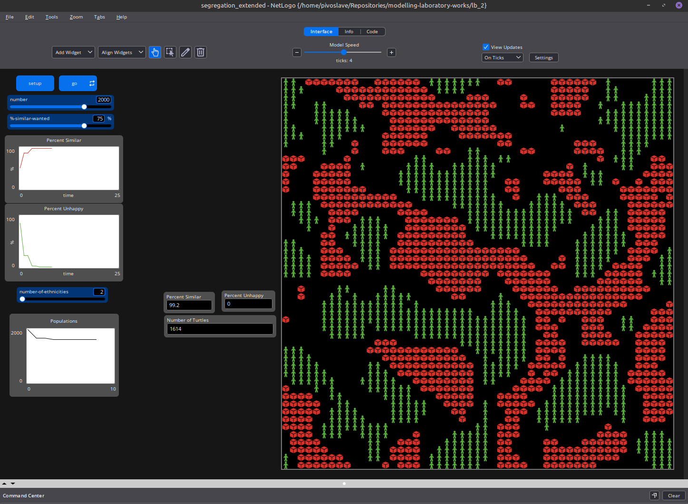

## Комп'ютерні системи імітаційного моделювання
## СПм-25-1, **Царенко Денис Олегович**
### Лабораторна робота №**3**. Використання засобів обчислювального інтелекту для оптимізації імітаційних моделей

 

### Варіант 8, модель Segregation Simple Extension 1, допрацьована

 

### Вербальний опис моделі

Симуляція опису зміни рівня щастя множини людей відповідно до кількості оточуючих, що відрізняються від них (у цій моделі - різні кольори черепах). На полотні створюється задана користувачем кількість черепах, що завжди є меншою за розмір полотна. Кількість кольорів - від 2 до 5(червоний, зелений, жовтий, синій, помаранчевий). Для кожної черепахи прораховується процент щастя (вираховується як середній процент черепах того ж кольору у восьми сусідніх клітинках), якщо він нижче за задану користувачем планку, то така черепаха шукає і переміщається на наступне найбільш підходяще місце (за розрахованими параметрами щастя) у радіусі 10 клітинок. Якщо ж такого місця не знайшлось, то черепаха повертається на рандомний кут та рухається рандомну кількість клітинок, до 10, допоки не знайде вільне місце таким чином. Після цього проходить розрахунок того, чи зникне черепаха. На цей показник впливають такі параметри як процент відмінних сусідів (коефіцієнт з вагою 4) та чи нещаслива черепаха (+15% до зникнення). На зменшення цього параметру впливає значення проценту схожих сусідів (коефіцієнт із вагою 20). Проходить тік, повторюється допоки кількість нещасливих черепах не стане 0. Результат виконання - групування черепах за кольором у одну або декілька груп з різним розміром, деякі черепахи стають вигнанцями без сусідів.

### Керуючі параметри:
- **number** - кількість черепах, які будуть створені
- **%-similar-wanted** - відсоток сусідів такого ж кольору, нижче якого черепаха вважатиметься нещасливою
- **number-of-ethnicities** - кількість видів (кольорів) черепах

### Внутрішні параметри
- **happy?** - булевий флаг, визначає чи агент щасливий
- **similar-nearby** - кількість черепах того ж кольору, що й агент у 8 сусідніх патчах
- **different-nearby** - кількість черепах-сусідів іншого кольору
- **total-nearby** - загальна кількість черепах-сусідів у 8 сусідніх патчах від агента

### Показники роботи системи
- середній відсоток схожих сусідів. У кінці симуляції не може бути менше за керуючий параметр %-similar-wanted.
- процент нещасливих агентів. Показує нестабільність системи та процентну кількість черепах, що на наступному тіку симуляції точно змінять своє місцезнаходження
- кількість черепах. Зменшується при зникненні черепахи, а якщо значення цієї змінної стане 0, то моделювання буде припинено.

### Опис експерименту, що проводився
Який набір вхідних даних призведе то найшвидшого виконання моделі при фіксованій стартовій кількості жителів у 2000 осіб?

У такому випадку, вхідні дані дослідення будуть такими:

![]Параметри пошуку](data-2.png)

Для спостереження використовується глобальна змінна ticks, яку оптимізаційна модель намагається мінімізувати. Значення вхідних (керуючих) змінних було імпортовано з файлу моделі, однак, як виходить з експерименту, стартова кількість черепах є фіксованою - 2000. 

## Генетичний алгоритм
Для генетичного алгоритму було обрано наступні дані:

Тобто, 1000 разів прогоняється модель, а розмір кожного покоління - 50. З цього виходить, що еволюційно найкращий результат буде найвищим з 20 поколінь моделей.

У такому випадку, результат роботи генетичного алгоритму буде наступним:

З цього виходить, що найоптимальнішим є такий набір: поріг терпимості - 72%, кількість національностей - 2. 

Перевіримо такі дані на моделі. В ході ручного тестування при 5 запусках середній час виконання моделі - 3.75 тактів:

Скріншот роботи моделі при таких параметрах:

## Випадковий підбір
Для випадкового підбору було виставлено наступні параметри пошукової моделі. Зауважу що поріг симуляцій було збільшено у 3 рази задля того, аби компенсувати більш хаотичний підхід при такому алгоритмі пошуку.

У цьому випадку, результат виконання випадкового пошуку буде наступним:

Маємо, що цей алгоритм дійшов до оптимальних параметрів у 75% порогу та 2 національності - не набагато далі, аніж генетичний алгоритм.

Скріншот роботи моделі при цих параметрах:

